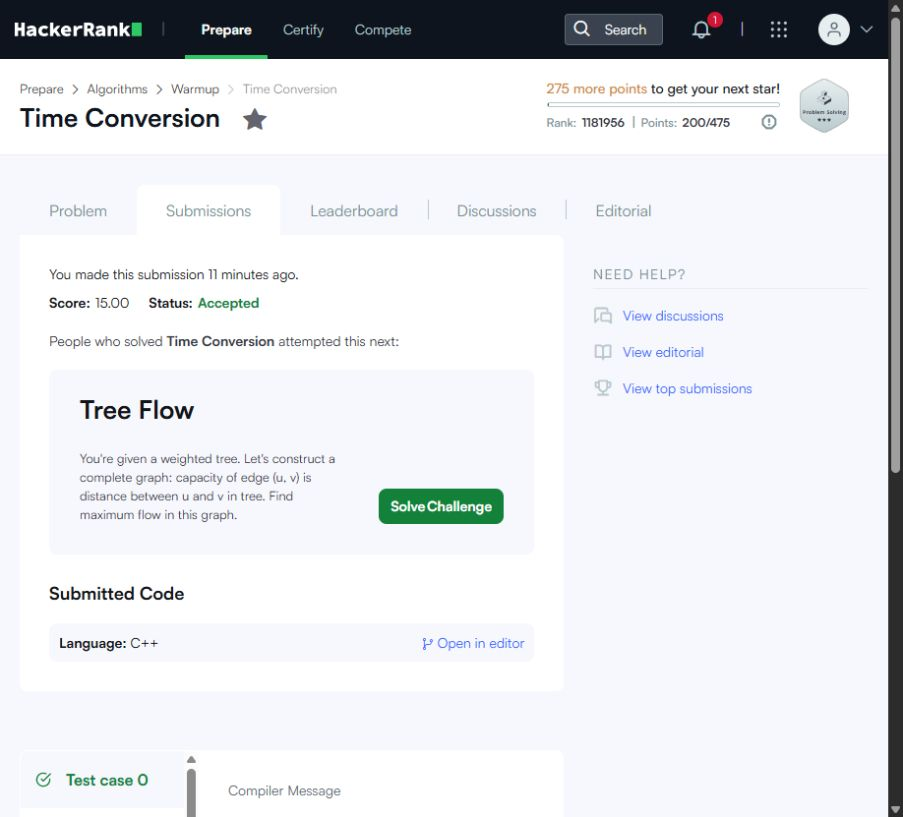
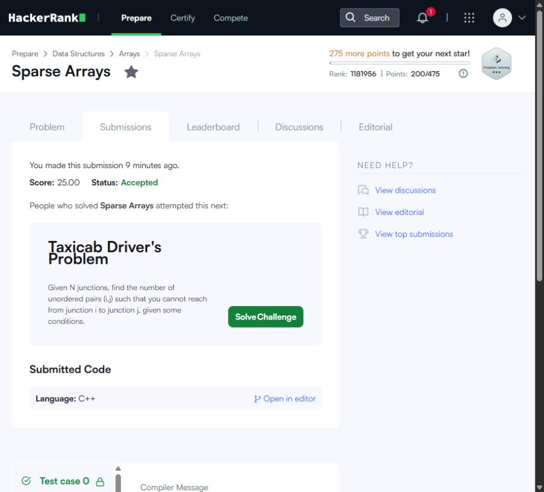

# HackerRank - Third Semester Portfolio

**Tharun Ramesh | R25EF295 | Semester 3 | Section F | Class 3F**

Portfolio Building B25CS0311 - Activity 8, 7 November 2026.

- [HackerRank profile](https://www.hackerrank.com/profile/tharunninja74)
- [Public repository](https://github.com/RealNinjaMC/HackerRank-3rdSem-Portfolio)
- [Local test record](TEST_RESULTS.json)
- [Submission records](SUBMISSIONS.json)
- [Badge record](BADGE.json)

## Mandatory problems

| Problem | Time | Space | Result |
|---|---|---|---|
| [Diagonal Difference](diagonal-difference/README.md) | O(n) function time; O(n^2) including reading the matrix | O(1) auxiliary; O(n^2) input matrix | [10 points](https://www.hackerrank.com/challenges/diagonal-difference/submissions/code/486762075) |
| [Dynamic Array](dynamic-array/README.md) | O(n + q) amortized | O(n + q) worst-case auxiliary storage | [15 points](https://www.hackerrank.com/challenges/dynamic-array/submissions/code/486762098) |
| [Time Conversion](time-conversion/README.md) | O(1), fixed ten-character input | O(1), fixed-size strings | [15 points](https://www.hackerrank.com/challenges/time-conversion/submissions/code/486762131) |
| [Compare the Triplets](compare-the-triplets/README.md) | O(1), exactly three comparisons | O(1) | [10 points](https://www.hackerrank.com/challenges/compare-the-triplets/submissions/code/486762189) |
| [Sparse Arrays](sparse-arrays/README.md) | Expected O(n + q) for bounded-length strings; O((n + q)^2) hash-collision worst case | O(u + q) entries, u distinct input strings, plus stored key characters | [25 points](https://www.hackerrank.com/challenges/sparse-arrays/submissions/code/486762215) |

## Mandatory submission evidence

### Diagonal Difference


### Dynamic Array


### Time Conversion


### Compare the Triplets


### Sparse Arrays


## Required badge

Verified **3-star Problem Solving badge, 200 points**, on the profile above. The five required problems contributed 75 points; six additional practice problems contributed 125. This is a practice badge, not a HackerRank Skills Certification.


## Additional badge practice

| Problem | Points | Result |
|---|---|---|
| [Arrays - DS](arrays-ds/README.md) | 10 | [Successful submission](https://www.hackerrank.com/challenges/arrays-ds/submissions/code/486762255) |
| [2D Array - DS](2d-array/README.md) | 15 | [Successful submission](https://www.hackerrank.com/challenges/2d-array/submissions/code/486762297) |
| [Left Rotation](array-left-rotation/README.md) | 20 | [Successful submission](https://www.hackerrank.com/challenges/array-left-rotation/submissions/code/486762323) |
| [Array Manipulation](crush/README.md) | 60 | [Successful submission](https://www.hackerrank.com/challenges/crush/submissions/code/486762358) |
| [Simple Array Sum](simple-array-sum/README.md) | 10 | [Successful submission](https://www.hackerrank.com/challenges/simple-array-sum/submissions/code/486762421) |
| [A Very Big Sum](a-very-big-sum/README.md) | 10 | [Successful submission](https://www.hackerrank.com/challenges/a-very-big-sum/submissions/code/486762453) |

## Reproduce local verification

Requirements: Python 3 and GCC with C++11 support. No Python packages are needed.

```powershell
python run_tests.py
```

On the original PC:

```powershell
python run_tests.py --compiler C:\MinGW\bin\g++.exe
```

All eleven programs passed 40 function checks and 22 stdin/stdout cases. Each source has a local-test main guarded by LOCAL_TEST and a normal judge main. Paste the complete file into HackerRank using C++11. Input follows the challenge contracts.

## Empirical measurements

[BENCHMARK.csv](BENCHMARK.csv) records mean microseconds per function call on this Windows PC, GCC 6.3.0, C++11, `-O0`. Input generation and file I/O are excluded. Different repetition counts reduce timer noise: diagonal 1000, dynamic 50, time/triplets 50000, sparse 20. Timings are observations, not a proof of asymptotic bounds. Sparse Arrays uses n input strings and n queries of key-like text. Dynamic Array uses one sequence and q alternating append/read operations.

```powershell
g++ -std=c++11 -O0 -Wall -Wextra -pedantic benchmark.cpp -o build/benchmark.exe
.\build\benchmark.exe
```

## Complexity clarification

The worksheet gives Dynamic Array O(n) space. The implementation needs O(n + q) in the worst case because appended values and answers grow with q. Diagonal Difference accesses O(n) diagonal elements, while reading the full matrix is O(n^2). Sparse Arrays has expected linear hash-table behavior for bounded string lengths; character hashing and collisions must also be considered.

## Work record

Prepared with AI assistance in the actual session on 7 November 2026. Source files were generated locally, compiled and tested before submission through the HackerRank browser editor. No editorial was opened. All screenshots show real results. Code uses descriptive names; algorithm explanations and edge cases are documented in the adjacent README files. Personal solving times were not recorded.

## Official sources

- [Scoring and badge thresholds](https://www.hackerrank.com/scoring)
- Challenge statements are linked in each problem folder.
